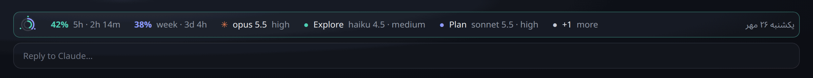
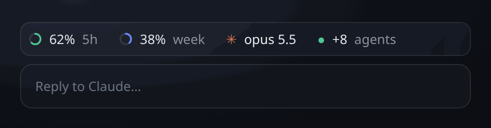

# halo

A quiet glass bar for [Claude Code](https://docs.claude.com/en/docs/claude-code), pinned above the prompt. At a glance:

- **Usage**: rings for the 5-hour and weekly rate limits, with the time until each resets
- **Models**: the model your session runs on, and every running subagent with its model, each with its effort level
- **Date**: today in the Jalali (Persian) or Gregorian calendar



On a narrow window, extra agents fold into a single chip:



<sub>Rendered from halo's own output with sample data: the tree the mod returns in the desktop app, drawn with the same colors and rings.</sub>

In the desktop app the bar is drawn as soft glass with real rings. In a terminal the same bar is drawn as plain colored text.

## Install

At the prompt of a terminal session:

```
/plugin install halo --marketplace Pooyamilani/claude-halo
```

From a shell:

```bash
claude plugin install halo --marketplace Pooyamilani/claude-halo
```

In the desktop app: click **+** next to the prompt box → **Plugins** → **Add marketplace** with `Pooyamilani/claude-halo` → **Add plugin**.

The install shows a screen with the options below. Installed at the user scope, halo appears in every new session.

## Options

| Option   | Values                                 | Default        |
| -------- | -------------------------------------- | -------------- |
| `usage`  | `both`, `5h`, `weekly`, `off`          | `both`         |
| `models` | `model+effort`, `model`, `off`         | `model+effort` |
| `date`   | `jalali`, `gregorian`, `off`           | `jalali`       |

Change them in the config menu, or in `~/.claude/settings.json`:

```json
"pluginConfigs": {
  "halo": { "usage": "both", "models": "model+effort", "date": "gregorian" }
}
```

With everything set to `off`, halo steps aside and leaves the band to Claude Code.

## How it fits

The bar sizes itself to the width it has. When there isn't room, it gives up details in this order:

1. Agents beyond what fits fold into a `+N agents` chip.
2. Reset times and effort levels drop.
3. The date drops.

Whatever is still too wide wraps onto a second line rather than overflowing.

## Good to know

- **Readings arrive with replies.** Usage readings come with each reply from Claude, so the rings show `–` until the first reply of a session.
- **Model and effort come from each request.** halo reads them from every request a session or subagent sends. An agent that was already running when halo loaded shows `inherit` until it sends its next request.
- **Redraw timing.** The bar redraws on every turn and whenever a limit moves. While a session sits idle, the countdown doesn't tick.

## Develop

```bash
git clone https://github.com/Pooyamilani/claude-halo
claude --plugin-dir ./claude-halo     # load it into a session; saves hot-reload
claude plugin validate ./claude-halo  # manifest + hooks check
claude plugin test ./claude-halo      # runs hooks/halo.test.tsx
```

## License

MIT
