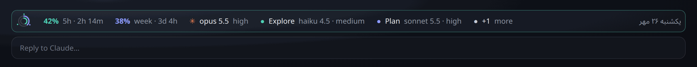
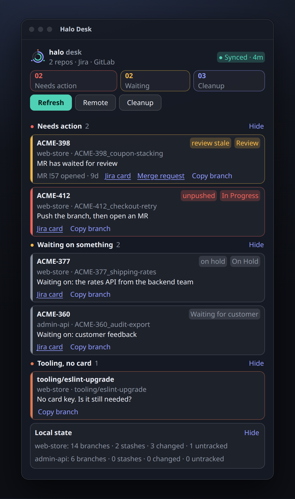
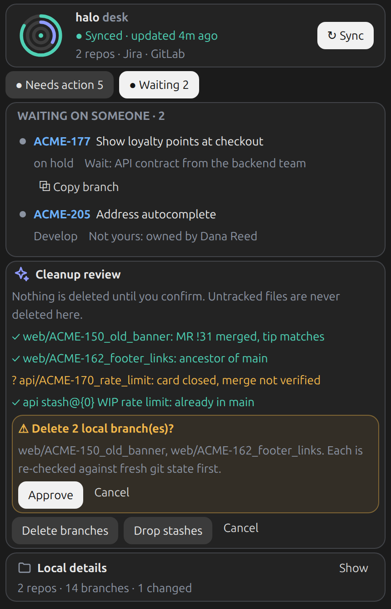

<p align="center">
  
</p>

<h1 align="center">Halo</h1>
<p align="center"><b>A modular workspace for Claude Code.</b><br>Know your session. Manage your work.</p>

<p align="center">
  <a href="https://github.com/Pooyamilani/claude-halo/releases"></a>
  <a href="LICENSE"></a>
  
</p>

Halo is a small family of plugins that add the things Claude Code leaves out: a view of your session, and a view of your work. Each plugin does one job, installs on its own, and has its own version, so you take only what you need.

| Plugin | Job | Where it lives |
| --- | --- | --- |
| [**Halo Usage**](plugins/halo-usage) · `halo-usage` | **Know your session.** Usage limits, running models and effort, the date. | A glass bar above your prompt |
| [**Halo Desk**](plugins/halo-desk) · `halo-desk` | **Manage your work.** What is actually open across your repos, Jira and GitLab, with safe cleanup. | A pane, opened with `/halo-desk` |

## Halo Usage: know your session

A quiet bar pinned above your prompt. One glance shows how much of your 5-hour and weekly limits is left (and when each resets), which models and subagents are working for you with their effort, and the date in Jalali or Gregorian. It makes no network calls and uses no model tokens.



[Read more about Halo Usage →](plugins/halo-usage)

## Halo Desk: manage your work

A pane that answers "what is actually open?". It reads your local git repos, cross-checks them against Jira and GitLab, and sorts every branch into **needs action**, **waiting**, or **tooling**, with the next step spelled out. A cleanup review lists branches proven merged and stashes already in the base, each with its evidence.

Nothing happens behind your back. Every action that fetches, writes or deletes shows an approval card first.

<table>
  <tr>
    <td width="50%"></td>
    <td width="50%"></td>
  </tr>
  <tr>
    <td align="center"><sub>The pane: what needs you, what is waiting</sub></td>
    <td align="center"><sub>Cleanup review, with evidence and an approval card</sub></td>
  </tr>
</table>

<sub>Screenshots are the pane's real element tree rendered with made-up sample data (a fictional "ACME" project).</sub>

[Read more about Halo Desk →](plugins/halo-desk)

## Install

Add the marketplace once, then install what you want:

```
/plugin marketplace add Pooyamilani/claude-halo
/plugin install halo-usage@halo      # the usage bar
/plugin install halo-desk@halo       # the work pane
```

In the desktop app: **+** next to the prompt box → **Plugins** → **Add marketplace** with `Pooyamilani/claude-halo`.

## Modular by design

- **Independent.** Installing one plugin never loads the other. Update or uninstall either at any time with `/plugin`.
- **Self-contained.** Each plugin carries everything it needs and reads nothing outside its own folder.
- **Separately versioned.** Each has its own version, changelog entries and release tag (`halo-usage-v…`, `halo-desk-v…`).
- **Room to grow.** New modules join the family only when they earn their place. An all-in-one bundle only if people ask for one.

## Compatibility

- Claude Code with plugins enabled (developed and tested on 2.1.x, in the desktop app and in terminals).
- Halo Usage draws above the prompt on the desktop app and in terminals. Halo Desk opens as a pane with `/halo-desk`.
- Halo Desk needs `git`. Jira and GitLab data is optional and read-only.

## Permissions and safety

- **Halo Usage** reads the usage and model data Claude Code already gives plugins. No network calls.
- **Halo Desk** runs read-only `git` commands. It reads Jira and GitLab only through a snapshot file you control: a token you name by environment variable, a browser you are already signed in to, or your own script. Credentials are never stored.
- **Approvals.** In Halo Desk, fetching, refreshing remote data, deleting branches and dropping stashes each ask first (Approve or Cancel). The only destructive operations are deleting local branches and dropping stashes, and each needs merge evidence. Untracked files are never deleted.

## Existing Halo users

Installed `halo` before it became a product? It keeps working and updating. See [Migrating](docs/migrating.md).

## Roadmap

- More screenshots and a short demo of Halo Desk in a real session.
- More modules under the Halo name when they are worth having.

## Contributing

See [CONTRIBUTING.md](CONTRIBUTING.md). Issues and ideas are welcome on the [issue tracker](https://github.com/Pooyamilani/claude-halo/issues).

## License

MIT. See [LICENSE](LICENSE).
