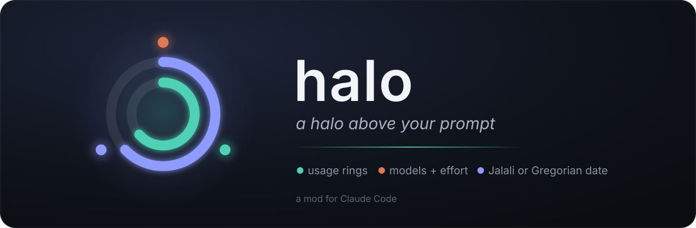
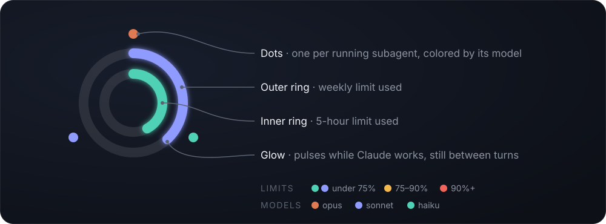
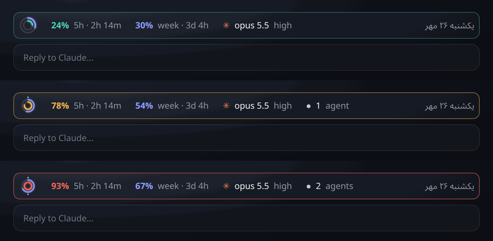
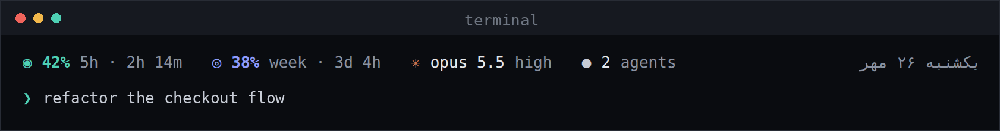

<p align="center">
  
</p>

<p align="center">
  <a href="https://github.com/Pooyamilani/claude-halo/releases"></a>
  <a href="LICENSE"></a>
  
</p>

**halo** is a quiet glass bar pinned just above your Claude Code prompt. One glance tells you how much of your limits is left, which models are working for you right now, and what day it is.


## What it shows

<table>
  <tr>
    <td width="33%" valign="top">
      <h3>◉ Usage</h3>
      Your <b>5-hour</b> and <b>weekly</b> limits as two nested rings, with the exact percent and the time until each resets.
    </td>
    <td width="33%" valign="top">
      <h3>✳ Models</h3>
      The model your session runs on and every running <b>subagent</b>, each with its model and <b>effort</b> level.
    </td>
    <td width="33%" valign="top">
      <h3>◷ Date</h3>
      Today in the <b>Jalali</b> calendar, like <bdi>یکشنبه ۲۶ مهر</bdi>, or the <b>Gregorian</b> one.
    </td>
  </tr>
</table>

## Reading the halo

<p align="center">
  
</p>

| You see | It means |
| --- | --- |
| Outer ring | Weekly limit used |
| Inner ring | 5-hour limit used |
| Ring color | Teal or blue is fine, **amber** past 75%, **red** past 90%. The number beside it uses the same color. |
| Bar outline | A faint teal glow, turning amber or red with whichever limit is tighter |
| Dots around the halo | One per running subagent: orange opus, blue sonnet, teal haiku |
| `▾` on the agents | Click an agent chip or the agent count: a table slides open inside the bar listing every running agent with its task, type, model and effort. Click again to close it. |
| Soft pulse | Claude is working. The halo is still between turns. |

Every value is also written out as text (`42% 5h · 2h 14m`), so the colors are a hint, never the only signal.

### Calm, warm, hot



### Any width

The bar sizes itself to the room it has. When space runs out it gives up details in this order:

1. Agents beyond what fits fold into `+N more`, or `N agents` when none fit.
2. Reset times and effort levels drop.
3. The date drops.

Anything still too wide wraps onto a second line instead of overflowing.


### In a terminal

A terminal can't draw rings, so each limit gets a colored `◉` (5-hour) or `◎` (weekly) instead. Everything else works the same.



<sub>All images are rendered from halo's own output with sample data: the layout the mod returns, drawn with the same colors and rings.</sub>

## Install

At the prompt of a terminal session:

```
/plugin install halo --marketplace Pooyamilani/claude-halo
```

From a shell:

```bash
claude plugin install halo --marketplace Pooyamilani/claude-halo
```

In the desktop app: click **+** next to the prompt box → **Plugins** → **Add marketplace** with `Pooyamilani/claude-halo` → **Add plugin**.

The install shows a screen with the options below. Installed at the user scope, halo appears in every new session.

## Options

| Option         | Values                               | Default        |
| -------------- | ------------------------------------ | -------------- |
| `usage`        | `both`, `5h`, `weekly`, `off`        | `both`         |
| `models`       | `model+effort`, `model`, `off`       | `model+effort` |
| `sessionModel` | `show`, `hide`                       | `show`         |
| `agentTable`   | `agents`, `agents+session`, `off`    | `agents`       |
| `date`         | `jalali`, `gregorian`, `off`         | `jalali`       |

- `sessionModel: hide` drops the main session's model from the bar, leaving room for running subagents.
- `agentTable` sets what clicking an agent chip opens: a table of every running agent (`agents`), the same with a row for this session (`agents+session`), or nothing (`off`).

Change them in the config menu, or in `~/.claude/settings.json`:

```json
"pluginConfigs": {
  "halo": {
    "options": { "sessionModel": "hide", "agentTable": "agents+session", "date": "gregorian" }
  }
}
```

With everything set to `off`, halo steps aside and leaves the band to Claude Code.

## Good to know

- **Readings arrive with replies.** Usage readings come with each reply from Claude, so the rings stay empty until the first reply of a session.
- **Model and effort come from each request.** halo reads them from every request a session or subagent sends. An agent that was already running when halo loaded shows `inherit` until it sends its next request.
- **Redraw timing.** The bar redraws on every turn and whenever a limit moves. While a session sits idle, the countdown doesn't tick.
- **Older version.** The plainer 1.0.0 design is kept as the [v1.0.0 release](https://github.com/Pooyamilani/claude-halo/releases/tag/v1.0.0).

## Develop

```bash
git clone https://github.com/Pooyamilani/claude-halo
claude --plugin-dir ./claude-halo     # load it into a session; saves hot-reload
claude plugin validate ./claude-halo  # manifest + hooks check
claude plugin test ./claude-halo      # runs hooks/halo.test.tsx
```

## License

MIT
