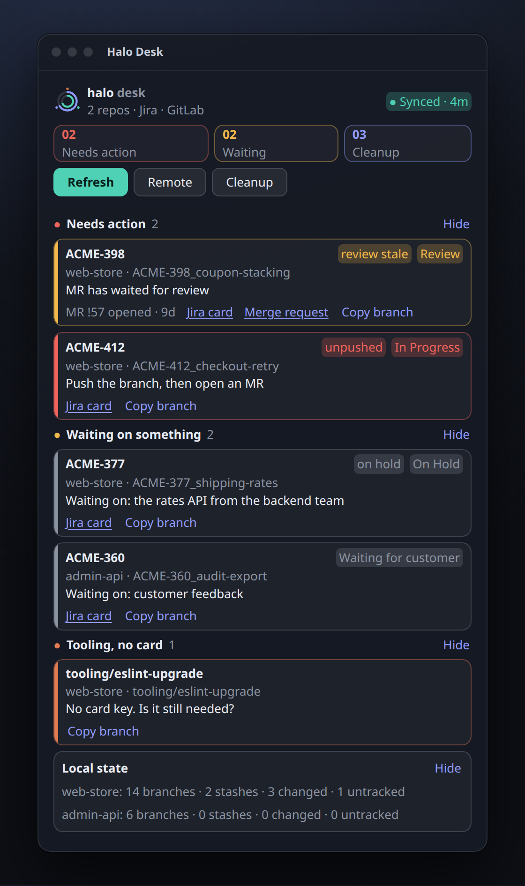
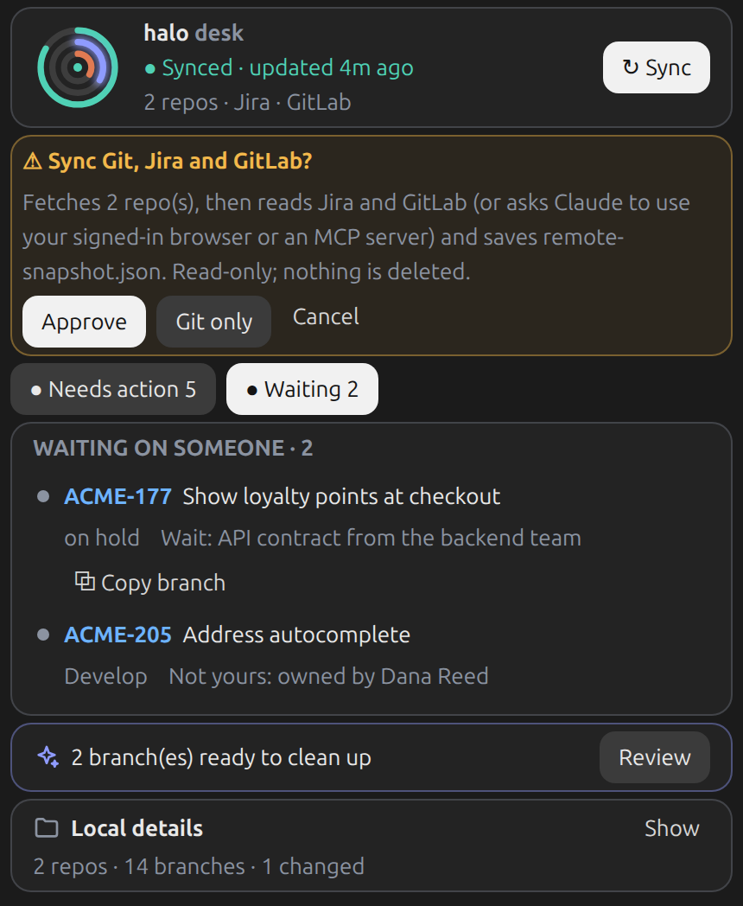
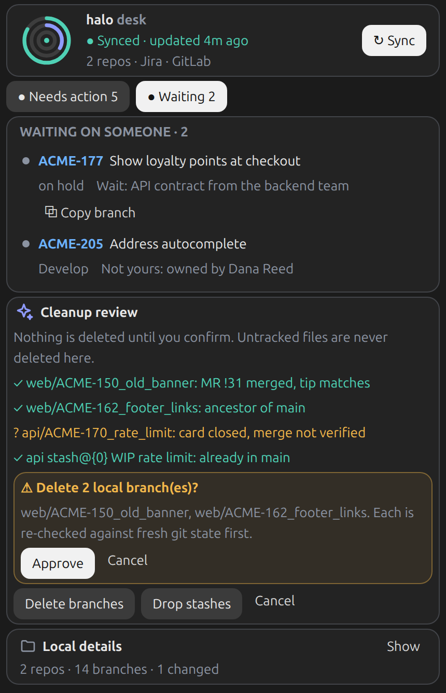

# Halo Desk

Part of [Halo](../../README.md), a modular workspace for Claude Code. A Claude Code pane that answers "what is actually open?" across your git repos, cross-checked against Jira and GitLab, and helps you clean up local leftovers safely. Nothing about your projects is built in: repos, hosts, status names and thresholds all live in a config file.

<p align="center">
  
  
</p>
<p align="center"><sub>Rendered from the pane's real element tree with made-up sample data (a fictional "ACME" project). Left: the pane. Right: the approval card raised by pressing Remote.</sub></p>

## What you get

- **Needs action now**: unpushed branches, MRs to review (stale ones flagged), pushed work with no MR, cards that look abandoned.
- **Waiting on something**: on-hold cards, plan notes that say "waiting for…", cards owned by someone else.
- **Tooling, no card**: branches without a card key.
- **Local state**: branches, stashes, changed and untracked files per repo.
- **Cleanup review**: branches proven merged and stashes already in the base, each with the evidence. Nothing is deleted until you approve it. Untracked files are listed, never deleted.

It works with git alone. Jira and GitLab data add the rest.

## Approvals

Halo Desk never acts on its own. Opening the pane only reads local git. Pressing **Refresh** (git fetch), **Remote** (Jira and GitLab data), **Delete branches** or **Drop stashes** raises an approval card that says what will run, with **Approve** and **Cancel**. Delete and drop re-check every item against fresh git state first.

<p align="center"></p>

## Install

```
/plugin marketplace add Pooyamilani/claude-halo
/plugin install halo-desk@halo
```

Halo Desk installs on its own, with or without Halo Usage.

Then add a project:

```
/halo-desk add ~/code/web --jira https://jira.example.com --base main
/halo-desk              # opens the pane
```

`add` detects the GitLab host and project path from `origin` and the base branch from `origin/HEAD` when you omit `--base`. See `examples/config.example.json` for every option. Config lives in `~/.claude/halo-desk/config.json` (change the folder with the `dataDir` option).

## Config

| Key | Meaning |
|---|---|
| `projects[].path`, `bases` | The repo and the branch(es) work merges into |
| `jira.baseUrl`, `keyRegex` | Jira host; where the card key sits in a branch name (default `PROJ-123` style) |
| `jira.closedStatuses` / `holdStatuses` / `activeStatuses` | Your status names. Left out, Jira's own status categories decide (done / in progress) |
| `gitlab.projectId`, `tokenEnv` | Numeric project id (resolved from the remote when absent); env var holding a token |
| `access.jira`, `access.gitlab` | `browser` (default) or `mcp`: how Remote reaches a source when no token is set |
| `staleReviewDays`, `idleDays` | Thresholds for "chase the review" and "untouched for weeks" |
| `noteGlobs`, `waitingMarkers` | Plan/notes files whose lines mark a card as waiting |
| `maxSnapshotAgeMinutes` | Deleting on MR evidence needs remote data newer than this |

Settings can be set per project (`projects[].jira`, `projects[].gitlab`) to mix several Jira or GitLab hosts.

## Getting remote data (Jira and GitLab)

A mod cannot read your browser's cookies, so the pane reads a **snapshot file**, `remote-snapshot.json` (format: `examples/remote-snapshot.example.json`). Anything can write it. The **Remote** button picks the first that applies:

1. **Tokens**: set `tokenEnv` on Jira and/or GitLab to the *name* of an environment variable holding a token. The token is read when you press Remote and is never written anywhere.
2. **Claude, through a browser or an MCP server**: with no `tokenEnv`, Remote asks Claude to collect the data and write the snapshot. `access.jira` / `access.gitlab` choose how, per source: `"browser"` (default; a browser you are already signed in to) or `"mcp"` (a Jira MCP such as `mcp-atlassian`, tools `mcp__jira__*`, and a GitLab MCP named `gitlab-mcp`, tools `mcp__gitlab-mcp__*`, connected in the session). If an MCP is missing, times out or not signed in, Claude stops and asks you before switching that source to the browser; it never switches on its own. The GitLab MCP cannot filter merge requests by source branch, so Claude lists them and matches branches itself. No tokens, no credentials stored by the mod.
3. **Your own script or cron job** that writes the file.

Expired sessions and failed sources show up in the pane; a card missing from the snapshot is never treated as done.

## How a branch is classified

In order, per card: closed and merged → nothing to do; open MR → review (stale after `staleReviewDays`; Jira/MR mismatch flagged); unpushed commits → push; pushed, active, no MR → open an MR; on hold or noted as waiting → waiting; active but cold → unclear; owned by someone else → waiting; no card key → tooling.

## Is it merged? (four tests)

MR merged with the same tip; ancestor of the base; every commit patch-equivalent in the base (`git cherry`); the branch's diff already applied to the base (squash). Only a positive result is evidence. A failed test is inconclusive, never "unmerged". `main`, `master`, `develop` and your bases are never offered for deletion, nor are the current branch or branches held by a worktree.

## Develop

```
cd plugins/halo-desk
claude plugin validate .
claude plugin test .
```

`src/` is plain TypeScript with no engine imports and is unit-tested with synthetic data; `hooks/register.tsx` is the only file that touches Claude Code.

## Limits

Jira REST v2 and GitLab API v4 only. Cards link out to Jira and the merge request, and offer Copy branch; there are no other row actions yet. Stash triage is a heuristic: unclear stashes are "ask", never dropped automatically.
